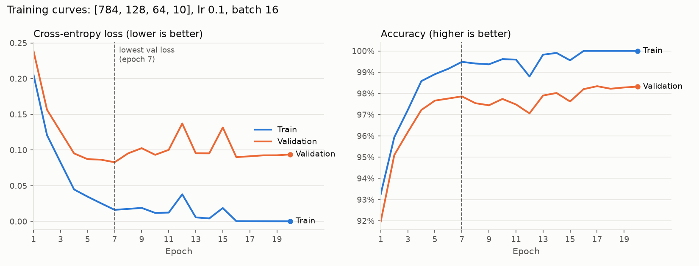
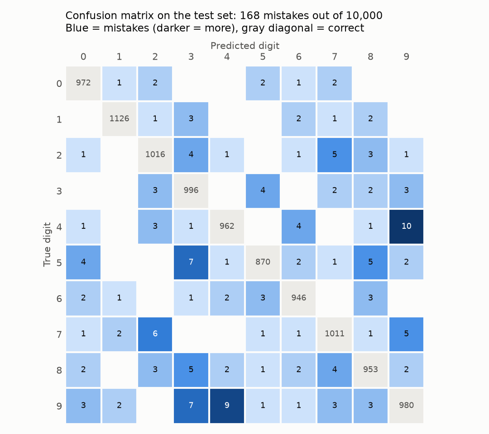
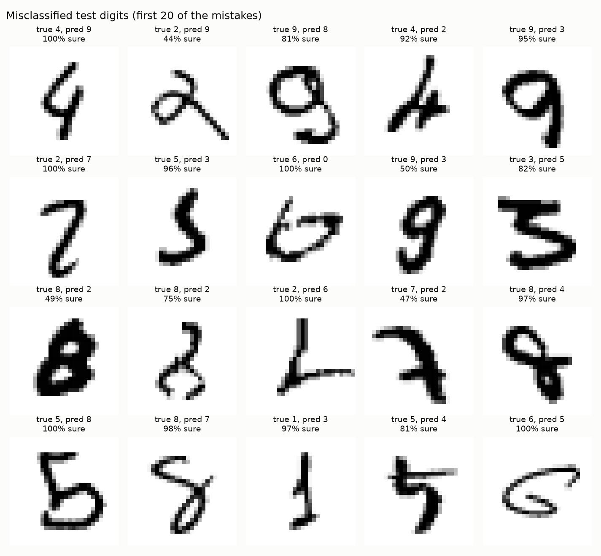

# MNIST Neural Network from Scratch

A handwritten digit classifier built with only Python and NumPy. No machine learning frameworks and no automatic differentiation. I'm writing every part by hand so I understand how a neural network actually learns.

**Final result: 98.32% accuracy on the 10,000-image MNIST test set** (168 mistakes), using a `[784, 128, 64, 10]` ReLU network trained for 20 epochs. The test set was used exactly once, after every setting had been chosen on a separate validation set.

## What works

- Data pipeline: loads MNIST, flattens and normalizes images, and splits the data (`data.py`)
- Single neuron with sigmoid and ReLU, vectorized and checked by hand (`neuron.py`)
- Numerically stable softmax with self-tests
- Layers and a full forward pass using He initialization (`layers.py`, `network.py`)
- Cross-entropy loss using log-softmax, stable for extreme values (`losses.py`)
- Backpropagation through every layer, derived by hand with the chain rule (`layers.py`, `network.py`)
- Gradient checking with centered finite differences: backprop matches the numerical gradients to a relative error of about 1e-9 (`gradient_check.py`)
- Mini-batch SGD training with per-epoch shuffling, tracking loss and train/validation accuracy (`train.py`)
- Hyperparameter sweeps over learning rate, hidden layer width, and batch size, each repeated across 3 seeds (`experiments.py`)
- Loss and accuracy curves over 20 epochs, used to choose the number of epochs (`evaluate.py`)
- One final test-set evaluation with a hand-built confusion matrix, per-digit accuracy, and a look at the misclassified digits (`evaluate.py`)

## How to run

```
python -m venv venv
venv\Scripts\activate        # Windows; on macOS/Linux: source venv/bin/activate
pip install numpy matplotlib torchvision
python gradient_check.py     # backprop vs numerical gradients
python train.py              # train with the chosen settings
python experiments.py        # hyperparameter sweeps (a few minutes)
python evaluate.py           # final training, test score, and all figures
```

## First training run

My first working setup, a `[784, 128, 64, 10]` ReLU network trained for 5 epochs (batch size 64, learning rate 0.1), reached **97.1% validation accuracy**. It became the baseline for the experiments below:

| Epoch | Loss | Train accuracy | Validation accuracy |
|---|---|---|---|
| 1 | 0.3404 | 92.76% | 92.30% |
| 2 | 0.1553 | 95.03% | 94.30% |
| 3 | 0.1111 | 96.69% | 96.02% |
| 4 | 0.0869 | 97.59% | 96.54% |
| 5 | 0.0698 | 98.35% | 97.14% |

## Hyperparameter experiments

`experiments.py` changes one hyperparameter at a time, keeping the rest at the baseline above, and compares settings on validation accuracy. Each setting is trained with 3 different seeds (different starting weights and shuffle order). The spread across seeds shows how much a score moves by chance alone, so a difference smaller than that spread doesn't count as evidence. All runs: 5 epochs.

**Learning rate** (sizes [784, 128, 64, 10], batch 64):

| Learning rate | Mean val accuracy | Range across seeds |
|---|---|---|
| 0.001 | 85.93% | 85.19% to 87.23% |
| 0.01 | 93.91% | 93.64% to 94.22% |
| **0.1** | **97.11%** | 96.94% to 97.20% |
| 0.5 | 96.57% | 95.34% to 97.34% |
| 1.0 | 61.79% | 12.10% to 93.24% |

Too small a learning rate is just slow: 0.001 is still improving after 5 epochs. Too large is unreliable: at 1.0, one seed collapsed to 12% (no better than guessing) while another reached 93%. With a single seed, 1.0 looked fine (95.6%) and 0.5 looked tied with 0.1. Running several seeds showed that both are unstable. 0.1 is both the best and the most consistent.

**Hidden layer width** (learning rate 0.1, batch 64):

| Sizes | Parameters | Mean val accuracy | Range across seeds | Train minus val | Time per run |
|---|---|---|---|---|---|
| [784, 32, 10] | ~25k | 95.59% | 95.48% to 95.72% | 0.53% | 1.9s |
| **[784, 128, 64, 10]** | ~109k | 97.11% | 96.94% to 97.20% | 1.30% | 4.7s |
| [784, 256, 128, 10] | ~235k | 97.29% | 97.06% to 97.42% | 1.46% | 9.6s |

The largest network scores 0.18% higher on average, but its range overlaps the baseline's, and it takes twice as long to train. The gap between train and validation accuracy grows with network size, which is consistent with bigger networks starting to memorize the training set. I kept [784, 128, 64, 10].

**Batch size** (sizes [784, 128, 64, 10], learning rate 0.1):

| Batch size | Updates per epoch | Mean val accuracy | Range across seeds | Time per run |
|---|---|---|---|---|
| **16** | 3,438 | **97.49%** | 97.26% to 97.66% | 7.4s |
| 64 | 860 | 97.11% | 96.94% to 97.20% | 4.6s |
| 256 | 215 | 95.60% | 95.46% to 95.68% | 3.4s |

Batch 256 runs fastest per epoch but takes only 215 steps per epoch, so it ends up undertrained. Batch 16 takes 4x the steps of batch 64 for only 1.6x the time, and its range doesn't overlap batch 64's. Smaller batches also take more steps in the same number of epochs, though, so I checked whether batch 16 wins only because it trained longer. Giving batch 64 the same time budget:

| Setup | Mean val accuracy | Range across seeds | Time per run |
|---|---|---|---|
| **Batch 16, 5 epochs** | **97.49%** | 97.26% to 97.66% | 7.3s |
| Batch 64, 8 epochs | 97.17% | 96.42% to 97.60% | 7.3s |

Three extra epochs barely helped batch 64 (97.11% to 97.17%), so batch 16's lead is not just from training longer. The ranges overlap, so with 3 seeds this is "better on average and more consistent," not proven.

**Batch size choice:** batch 16. With the seed `train.py` uses, a 5-epoch run at batch 16 reached 96.98% validation accuracy, slightly below the batch 64 run in the first table (97.14%). That's a reminder that one run's final-epoch number moves by a few tenths of a percent from run to run. This is why the comparisons above use averages over several seeds.

## Training curves and number of epochs

To choose how long to train, `evaluate.py` trains the chosen network for 20 epochs and plots loss and accuracy on the training and validation sets after every epoch:



- **Overfitting is visible in the loss.** Validation loss is lowest at epoch 7 (0.083) and then creeps up, while training loss falls to nearly 0. By epoch 16 the network gets 100% of the training images right: it has memorized them.
- **Validation accuracy still improves anyway**, from 97.86% at epoch 7 to about 98.3% from epoch 16 on. The network gets more images right overall but becomes very confident on the few it still gets wrong, and cross-entropy punishes confident mistakes heavily. So loss and accuracy disagree about when to stop.
- **The spikes at epochs 12 and 15** look like bad steps from a learning rate that's a bit high for batch 16. After epoch 16 the gradients are close to 0, so the curves flatten.

Since the goal is accuracy on new digits, I chose 20 epochs, which lands in the flat, stable stretch rather than on one lucky epoch. This comes from a single seed, so the exact best epoch would move a little with another seed.

**Chosen settings:** [784, 128, 64, 10], learning rate 0.1, batch size 16, 20 epochs.

## Test set evaluation

After every setting was fixed, the trained network was scored once on the 10,000 test images:

| Set | Loss | Accuracy |
|---|---|---|
| Train | 0.0002 | 100.00% |
| Validation | 0.0938 | 98.32% |
| **Test** | **0.0825** | **98.32%** |

Test accuracy matches validation accuracy. Because no decision was made using the test set, this shows the validation score was a fair estimate and choosing settings on it did not overfit to it.

### Confusion matrix

Rows are the true digit and columns are the network's prediction. I built it with a plain loop in NumPy (`confusion_matrix()` in `evaluate.py`) and checked it two ways: it sums to 10,000, and its off-diagonal cells add up to the same 168 mistakes that the accuracy function counts.



- **The most common mistakes are the ones people make too:** 4 → 9 (10) and 9 → 4 (9), then 5 → 3 (7), 9 → 3 (7), and 7 → 2 (6). Mistakes between similar shapes suggest the network learned real stroke patterns rather than something arbitrary.
- **Per-digit accuracy** ranges from 99.2% for 0 and 1 (a closed loop and a single stroke) down to 97.5% for 5 and 97.1% for 9, the digits involved in the most confusions.

### Misclassified digits

The first 20 mistakes in test-set order (not hand-picked), each with how confident the network was in its wrong answer:



- **Most are ambiguous handwriting**, like a 4 with a closed top or a 6 that is mostly a loop. A person could misread several of these too.
- **A few are clear digits it should have gotten right**, such as two readable 9s called 3 and a bold 8 called 2. These are its real weak spots.
- **It is often very confident when wrong**: 6 of these 20 say 100% sure. This is the same overconfidence seen in the training curves, where validation loss rose after epoch 7 even as accuracy kept improving.

## A note on torchvision

`data.py` uses `torchvision` for one thing only: downloading the raw MNIST files. The data is converted to plain NumPy arrays immediately, and PyTorch is not used anywhere else. The model, forward pass, backpropagation, loss, and training are all written in NumPy.

## Next steps

- Code cleanup and a short write-up of what I learned
- A PyTorch and CNN version to compare against. A CNN looks at nearby pixels together, which should help with the shape confusions above (aiming for about 99%)

## How I use AI

I use Claude as a coding assistant on this project. I review and test its output, and I verify the math by hand.
